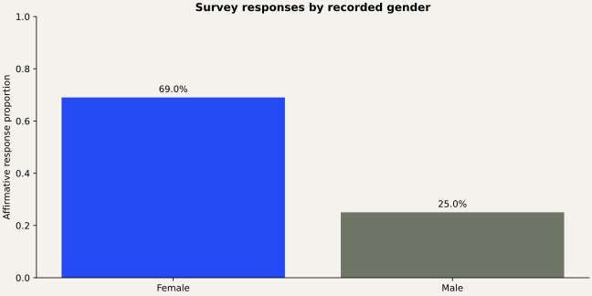

# Survey Response Association

Contingency-table analysis, expected counts, and relative risk for an aggregated response survey.

## The question

Is an affirmative survey response associated with recorded gender, and what is the relative risk?

## Approach

The four supplied aggregate counts total 27,802 responses. Sex and outcome ordering are explicit, so relative risk refers to Female Yes / Male Yes. Observational association does not imply a causal effect or describe individual honesty.

## Findings

Affirmative responses are 69.02% in the Female category and 25.05% in the Male category. Relative risk (Female/Male) is 2.7556, with a log-Wald 95% CI of 2.6695–2.8445. Pearson chi-square is 5351.94 (df=1, p<0.0001). Numerical software underflows the p-value to zero; this does not mean an exact probability of zero.

See `validation/results.md` for full numeric evidence.

## Run in SAS

Requires SAS 9.4 with SAS/STAT and ODS Graphics (or an equivalent licensed SAS Studio environment).

1. Download/clone this repository.
2. Set `project_root` in `src/config.sas` to its absolute directory.
3. Open `run.sas`. If SAS is not started in the repository directory, change its first `%include` to the absolute path to `src/config.sas`.
4. Submit the whole program. The HTML report is written to `outputs/analysis.html`.
5. Review the SAS log for errors and warnings before interpreting results.

## Repository guide

- `src/analysis.sas`: analysis procedures and explanatory comments.
- `src/config.sas`: one root-path setting and shared execution checks.
- `data/`: analysis inputs and schema/provenance notes.
- `docs/`: methods and recovery decisions.
- `validation/`: independent numerical checks when inputs are available.

## Validation status

Independent calculations are documented in `validation/results.md`. SAS runtime execution is pending because SAS is not installed in the preparation environment.

## Authorship and provenance

Analysis supplied by Abhinav Tanwar; packaging and source recovery are documented in `docs/provenance.md`. These are analytical portfolio projects. No employer affiliation or production deployment is implied. Data retain their original ownership; no dataset license is invented.
